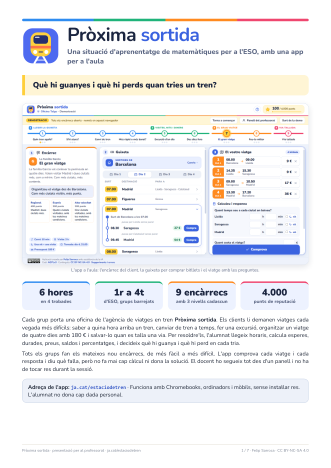
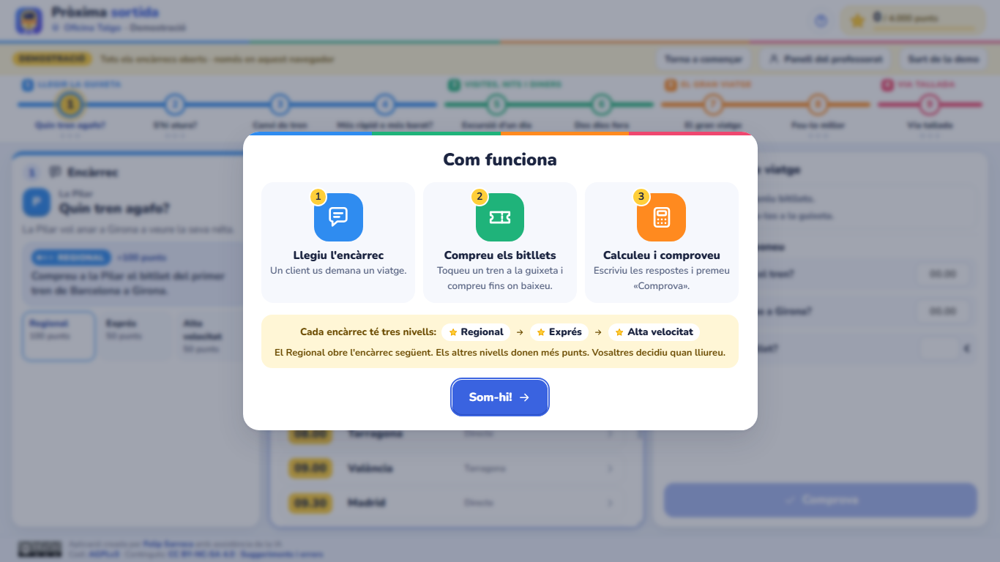
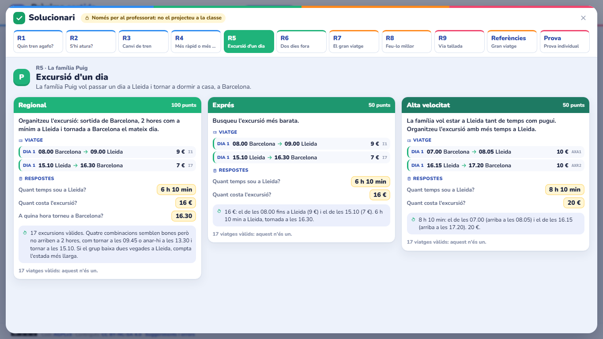
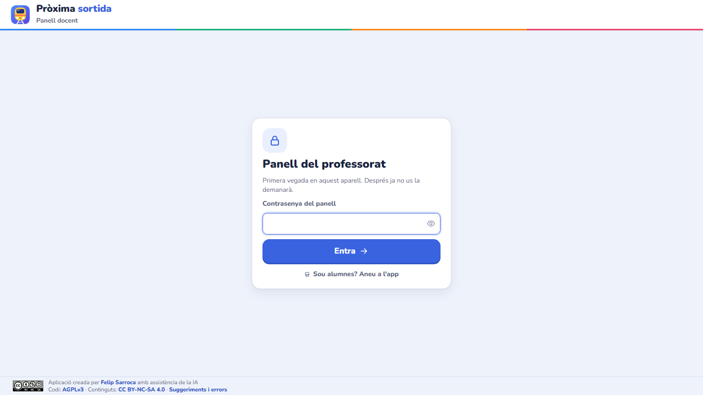
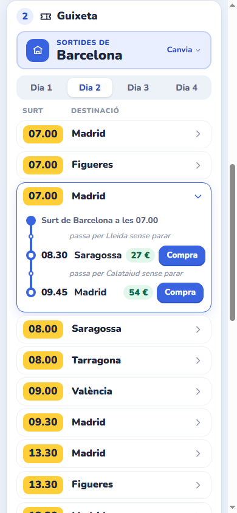

# Pròxima sortida · Agència de viatges en tren

**Pròxima sortida** és l'app de la situació d'aprenentatge de ferrocarril de matemàtiques (1r a 4t d'ESO). Cada grup porta una oficina d'una agència de viatges en tren. Els clients li fan encàrrecs cada vegada més difícils: llegir una sortida, canviar de tren, fer una excursió, organitzar un viatge de quatre dies per 180 € i salvar-lo quan es talla una via. Cada encàrrec ben resolt dona punts de reputació, fins a 4.000.

L'app **no fa els càlculs per l'alumnat**: la guixeta dona l'hora i el preu de cada bitllet, però les esperes, les estones de visita, els totals i les diferències els calcula el grup i els escriu. L'app comprova si són correctes.

> Enllaç: **[ja.cat/estaciodetren](https://ja.cat/estaciodetren)** · Professorat: botó «Professorat» de l'app ([docent.html](https://felipsarroca.github.io/jocs/Ferrocarril/docent.html)) · [Manual del professorat](https://felipsarroca.github.io/jocs/Ferrocarril/manual.html)

---

## Presentació per al professorat

**[Baixeu la presentació (PDF, 7 pàgines)](docs/presentacio-proxima-sortida.pdf)** · També es baixa des del panell del professorat (botó «Presentació»).

| Pàgina | Contingut |
|---|---|
| 1 | Què és: la pregunta de la SdA, l'app a l'aula i les xifres clau (6 hores en 4 trobades, 1r a 4t d'ESO, 9 encàrrecs, 4.000 punts). |
| 2 | Com funciona: els nou encàrrecs, els tres nivells, les regles del viatge i la via tallada. |
| 3 | A l'aula: les quatre trobades, què s'obre a cada una i què fa el docent, i l'app de l'alumnat. |
| 4 | Preparació (1): les tres claus (contrasenya del panell, tanda i PIN), com entra un grup, què fer si falla i els passos abans de la primera trobada. |
| 5 | Preparació (2): què cal imprimir, quantes còpies i com es retalla, què va a cada taula i l'explicació inicial a l'alumnat. |
| 6 | Seguiment i avaluació: el panell, el solucionari, la nota i els criteris d'avaluació (Decret 175/2022). |
| 7 | Privacitat, imprevistos, com fer-la servir en una altra escola i llicència. |

## Feu-la servir a la vostra escola

L'app és lliure. La guia **[DUPLICAR.md](DUPLICAR.md)** explica pas a pas, sense programar, com fer-ne una còpia amb la vostra pròpia base de dades: fork a GitHub, GitHub Pages, projecte de Firebase (gratuït), regles de seguretat, configuració de `js/config.js` i contrasenya del panell. Calen una hora i un compte de GitHub i un de Google.

Els materials per imprimir (mapa A3, full de regles, full de càlculs, guia de les trobades i quadern de panells de reserva) són a [`docs/materials`](docs/materials).

---

## Captures de pantalla

### La pantalla de treball: 1 encàrrec, 2 guixeta, 3 el vostre viatge

### Accés: codi de la tanda, grup i PIN

### «Com funciona»: la guia de tres passos que surt en entrar

### Cada nivell aconseguit es celebra i diu què es pot fer després

### Panell del professorat: calendari de les trobades, nivells, grups encallats i errors de la classe

### Solucionari: per a cada encàrrec i nivell, un viatge correcte, les respostes i les trampes habituals

### La porta del panell: la contrasenya es demana una sola vegada en cada aparell

### Al mòbil, en una sola columna

---

## Disseny

- **Clar i juvenil.** Fons blau molt clar, targetes blanques, tipografia arrodonida (Nunito, inclosa a l'app) i un logo nou: un tren de cara, groc sobre blau, que es reconeix a 16 px.
- **Tres passos numerats.** La pantalla de treball té tres columnes: **1 Encàrrec**, **2 Guixeta** i **3 El vostre viatge**. El pas que toca (comprar o calcular) es ressalta sol, i la guia «Com funciona» (botó **?**) ho explica amb tres dibuixos.
- **La petició del client, ben visible.** Cada encàrrec mostra el nivell que toca (Regional, Exprés o Alta velocitat) amb els seus punts. Als encàrrecs de millora (7, 8 i 9) es veuen els tres objectius alhora.
- **La línia dels encàrrecs.** Els nou encàrrecs són les parades d'una línia de tren, amb el nom de cada bloc i un color per bloc: blau (llegir la guixeta), verd (visites, nits i diners), taronja (el gran viatge) i vermell (via tallada).
- **La guixeta.** Un botó gran per triar l'estació (totes en una graella), els dies en pestanyes i les sortides amb l'hora en groc. Si toqueu un tren, les parades es dibuixen com una línia amb l'hora, el preu i el botó «Compra».
- **Bitllets amb forma de bitllet,** del color del bloc. L'app no suma mai els preus.
- **Celebració de cada nivell,** amb els punts guanyats i el pas següent (provar el nivell següent, passar a l'encàrrec següent o lliurar).
- **Aprofita la pantalla.** S'escala a l'espai útil: es redueix als portàtils de 1366 × 768 (també amb l'escalat del sistema al 125 %) i s'amplia una mica a les pantalles grans.

---

## Com funciona a l'aula

- **Nou encàrrecs iguals per a tothom**, en quatre blocs que s'obren sols el dia de cada trobada: llegir la guixeta (R1–R4), visites, nits i diners (R5–R6), el gran viatge (R7–R8) i la via tallada (R9).
- **Tres nivells per encàrrec:** Regional (la fita), Exprés i Alta velocitat. L'encàrrec següent s'obre quan el grup aconsegueix el Regional. L'app no diu mai quan s'ha de lliurar: el grup gestiona el temps i decideix què lliura i quan.
- **Cinc grups classe (Alfa, Beta, Gamma, Delta, Èpsilon):** una tanda per a cadascun, amb els mateixos noms de grups de treball (Talgo, Alvia…). La targeta d'accés i la capçalera de l'alumnat mostren el grup classe.
- **Punts de reputació:** 100/50/50 a R1–R6, 400/200/200 a R7 i R8 i 600/300/300 a R9. Un nivell fet amb ajuda del docent val la meitat. Nota de grup = punts / 1000.
- **«Comprova»** diu el primer problema en llenguatge planer, sense donar mai la solució.
- **Seguiment al panell:** marca «Encallat» (3 intents seguits amb errors o 12 min sense cap nivell), mostra els darrers errors de cada grup en paraules planeres i el viatge en curs, i una franja «Errors de la classe» amb els errors repetits en dos o més grups (darrers 30 min).
- **Via tallada:** el dia de la trobada 4, cada grup rep un tall diferent calculat a partir del seu gran viatge, amb una reparació mínima precalculada.

## Accés

- **Alumnat (`index.html`):** codi de la tanda, nom del grup i PIN de quatre xifres. Cap dada personal.
- **Contrasenya del panell:** la primera vegada en cada aparell, el panell demana la contrasenya del panell. No es desa enlloc: el solucionari es publica xifrat (`dades/solucionari.xifrat.json`, AES-GCM amb una clau derivada de la contrasenya amb PBKDF2) i la contrasenya és bona si l'obre. Aleshores la clau es guarda a l'aparell i ja no es torna a demanar. «Tanca el panell en aquest aparell» l'oblida, i «Canvia la contrasenya del panell» baixa el solucionari xifrat amb una contrasenya nova, que s'activa en pujar-lo a `dades/`.
- **Professorat (`docent.html`, botó «Professorat»):** cada tanda té, a més, la seva contrasenya de la tanda. S'hi entra des de qualsevol aparell amb el codi de la tanda i aquesta contrasenya. En crear la tanda, el docent posa les dates de les quatre trobades: els blocs i la via tallada s'obren sols, i durant la sessió no cal tocar res. Després de cada sessió marca les ajudes; al final exporta un CSV. Hi ha un botó «Obrir abans d'hora» per a imprevistos.
- **Demostració (`?demo`):** [felipsarroca.github.io/jocs/Ferrocarril/?demo](https://felipsarroca.github.io/jocs/Ferrocarril/?demo) entra sense codi com el grup Talgo, amb els nou encàrrecs oberts. Les dades es desen només al navegador, separades de les tandes reals; la barra de baix permet tornar a començar i obrir el panell del professorat de la demo.
- **Solucionari (botó «Solucionari» del panell):** a pantalla completa, amb una pestanya per encàrrec. Cada nivell mostra un viatge correcte (bitllets amb dia, hores, preu i codi del tren), les respostes i les trampes habituals; la via tallada mostra el tall i la reparació més barata de cada grup de la tanda, amb les respostes calculades. També hi ha els viatges de referència del gran viatge i les solucions de la prova individual.
- **Manual (`manual.html`):** guia breu del professorat, enllaçada des del panell, amb els materials per imprimir.

## Arquitectura

- JavaScript natiu amb mòduls ES, sense dependències ni compilació.
- Firestore (projecte `proxima-sortida-cat`, eur3) amb accés anònim i regles a `firebase/firestore.rules`; es despleguen des de `firebase/` amb `firebase deploy --only firestore:rules,auth --project proxima-sortida-cat`. Amb `FIREBASE_CONFIG = null` a `js/config.js`, funciona en **mode local** amb `localStorage`.
- `dades/dades.json` (horari, encàrrecs, reparacions mínimes), `proves/vectors.json` i `dades/solucionari.xifrat.json` es generen amb el verificador de la SdA (`SOLUCIONARI_CLAU=… python Verificador/exporta.py`). No s'editen a mà. El solucionari no es publica mai en clar.
- `eines/solucionari.mjs` xifra el solucionari, en canvia la contrasenya (`canvia`) o comprova si una contrasenya l'obre (`comprova`). Fa servir el mateix `js/xifratge.js` que el navegador.
- `docs/presentacio-proxima-sortida.pdf` es genera amb `Verificador/presentacio.py`, i `docs/materials/` amb `Verificador/materials.py`.
- `js/avaluador.js` és una còpia exacta de l'avaluador de referència en Python. Prova: `node proves/prova-avaluador.mjs` (2.926 casos idèntics).
- Les regles de Firestore es proven amb l'emulador local: `firebase/prova-regles.mjs` (82 casos; instruccions a la capçalera del fitxer).
- La interfície s'escala a l'espai útil de la finestra (referència 1440 × 740, entre el 72 % i el 125 %) i passa a una columna en pantalles estretes.

| Fitxer | Funció |
|---|---|
| `js/alumnat.js` | App de l'alumnat: accés, carril d'encàrrecs, guixeta i viatge. |
| `js/docent.js` | Panell docent. |
| `js/solucionari.js` | Porta del panell, solucionari i canvi de contrasenya. |
| `js/xifratge.js` | Xifratge del solucionari (AES-GCM i PBKDF2), al navegador i a Node. |
| `js/agencia.js` | Tandes, grups, desbloqueig, correcció de respostes i punts. |
| `js/avaluador.js` | Regles del viatge, nivells i valors de les preguntes. |
| `js/magatzem.js` | Desament a Firestore o en local amb la mateixa interfície. |
| `js/textos.js` | Missatges a l'alumnat. |
| `js/escala.js` | Adaptació a la pantalla. |

## Autoria i llicència

Aplicació creada per [Felip Sarroca](https://ja.cat/felipsarroca) amb assistència de la IA.

Codi: [AGPLv3](LICENSE) · Continguts: [CC BY-NC-SA 4.0](https://creativecommons.org/licenses/by-nc-sa/4.0/deed.ca) · [Suggeriments i errors](https://github.com/felipsarroca/jocs/issues/new?template=ferrocarril.yml)
