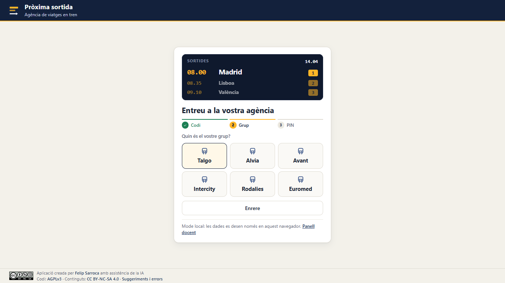

# Pròxima sortida · Agència de viatges en tren

**Pròxima sortida** és l'app de la situació d'aprenentatge de ferrocarril de matemàtiques (1r a 4t d'ESO). Cada grup porta una oficina d'una agència de viatges en tren. Els clients li fan encàrrecs cada vegada més difícils: llegir una sortida, canviar de tren, fer una excursió, organitzar un viatge de quatre dies per 180 € i salvar-lo quan es talla una via. Cada encàrrec ben resolt dona punts de reputació, fins a 4.000.

L'app **no fa els càlculs per l'alumnat**: la guixeta dona l'hora i el preu de cada bitllet, però les esperes, les estones de visita, els totals i les diferències els calcula el grup i els escriu. L'app comprova si són correctes.

> Enllaç: **[ja.cat/estaciodetren](https://ja.cat/estaciodetren)** · Panell docent: [docent.html](https://felipsarroca.github.io/jocs/Ferrocarril/docent.html)

---

## Captures de pantalla

### El gran viatge: l'encàrrec, la guixeta i el viatge amb les preguntes

### Accés: codi de la tanda, grup i PIN

### Panell docent: blocs, avís de via tallada, nivells i punts de cada grup

### Al mòbil, en una sola columna

---

## Disseny

- **La línia dels encàrrecs.** Els nou encàrrecs són les parades d'una línia de tren. Cada bloc té el seu color: blau (llegir la guixeta), verd (visites, nits i diners), taronja (el gran viatge) i vermell (via tallada). Els trams dels blocs que encara no s'han obert surten amb una línia discontínua.
- **La guixeta és un panell de sortides:** hores en groc sobre fons fosc, destinació i parades. Si toqueu un tren, s'obren les seves parades amb l'hora, el preu i el botó «Compra».
- **Cada bitllet comprat sembla un bitllet de veritat,** amb el número, el dia, la sortida, l'arribada i el preu. L'app no suma mai els preus.
- **Una barra de punts** a la capçalera mostra la reputació de l'oficina, fins a 4.000 punts.

---

## Com funciona a l'aula

- **Nou encàrrecs iguals per a tothom**, en quatre blocs que obre el docent: llegir la guixeta (R1–R4), visites, nits i diners (R5–R6), el gran viatge (R7–R8) i la via tallada (R9).
- **Tres nivells per encàrrec:** Regional (la fita), Exprés i Alta velocitat. L'encàrrec següent s'obre quan el grup aconsegueix el Regional; els grups ràpids proven els nivells alts abans de lliurar.
- **Punts de reputació:** 100/50/50 a R1–R6, 400/200/200 a R7 i R8 i 600/300/300 a R9. Un nivell fet amb ajuda del docent val la meitat. Nota de grup = punts / 1000.
- **«Comprova»** diu el primer problema en llenguatge planer, sense donar mai la solució.
- **Via tallada:** quan el docent activa l'avís, cada grup rep un tall diferent calculat a partir del seu gran viatge, amb una reparació mínima precalculada.

## Accés

- **Alumnat (`index.html`):** codi de la tanda, nom del grup i PIN de quatre xifres. Cap dada personal.
- **Docent (`docent.html`):** crea la tanda, obre els blocs, activa la via tallada, imprimeix les targetes d'accés, marca ajudes, reobre encàrrecs i exporta un CSV.

## Arquitectura

- JavaScript natiu amb mòduls ES, sense dependències ni compilació.
- Firestore (projecte `proxima-sortida-cat`, eur3) amb accés anònim i regles a `firebase/firestore.rules`; es despleguen des de `firebase/` amb `firebase deploy --only firestore:rules,auth --project proxima-sortida-cat`. Amb `FIREBASE_CONFIG = null` a `js/config.js`, funciona en **mode local** amb `localStorage`.
- `dades/dades.json` (horari, encàrrecs, reparacions mínimes) i `proves/vectors.json` es generen amb el verificador de la SdA (`Verificador/exporta.py`). No s'editen a mà.
- `js/avaluador.js` és una còpia exacta de l'avaluador de referència en Python. Prova: `node proves/prova-avaluador.mjs` (2.926 casos idèntics).
- Les regles de Firestore es proven amb l'emulador local: `firebase/prova-regles.mjs` (57 casos; instruccions a la capçalera del fitxer).
- La interfície s'escala a l'espai útil de la finestra (referència 1440 × 800) i passa a una columna en pantalles estretes.

| Fitxer | Funció |
|---|---|
| `js/alumnat.js` | App de l'alumnat: accés, carril d'encàrrecs, guixeta i viatge. |
| `js/docent.js` | Panell docent. |
| `js/agencia.js` | Tandes, grups, desbloqueig, correcció de respostes i punts. |
| `js/avaluador.js` | Regles del viatge, nivells i valors de les preguntes. |
| `js/magatzem.js` | Desament a Firestore o en local amb la mateixa interfície. |
| `js/textos.js` | Missatges a l'alumnat. |
| `js/escala.js` | Adaptació a la pantalla. |

## Autoria i llicència

Aplicació creada per [Felip Sarroca](https://ja.cat/felipsarroca) amb assistència de la IA.

Codi: [AGPLv3](LICENSE) · Continguts: [CC BY-NC-SA 4.0](https://creativecommons.org/licenses/by-nc-sa/4.0/deed.ca) · [Suggeriments i errors](https://github.com/felipsarroca/jocs/issues/new?template=ferrocarril.yml)
