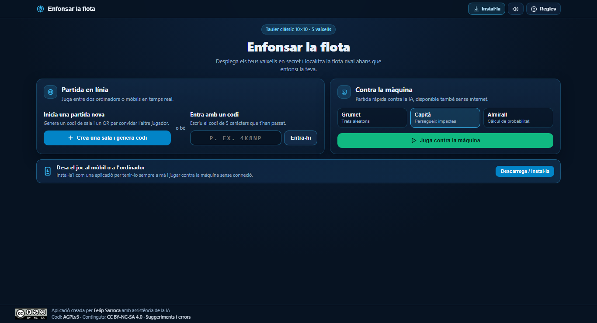
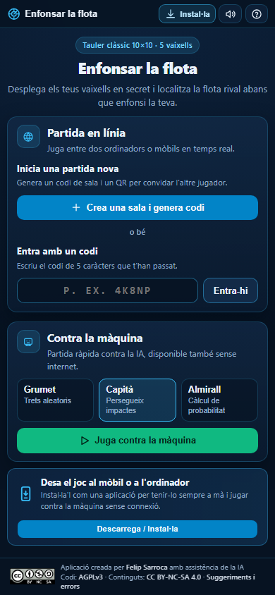
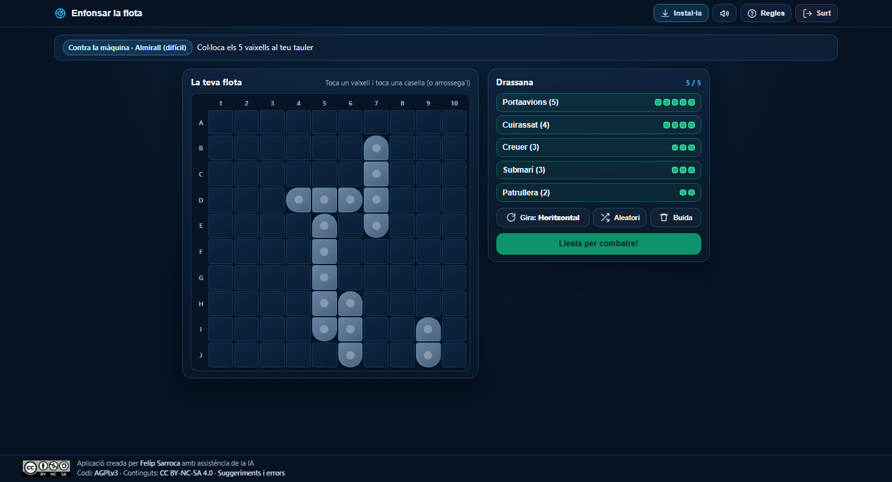
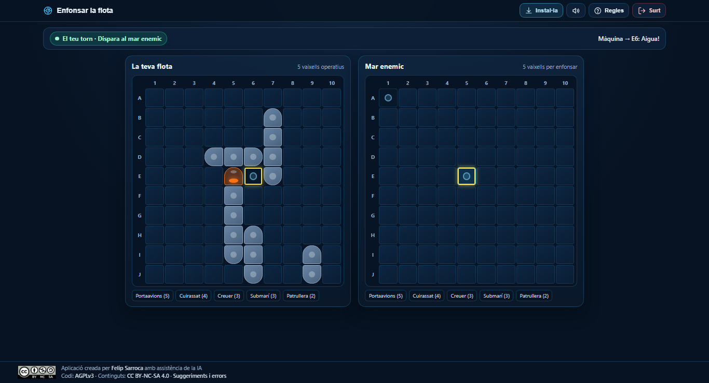
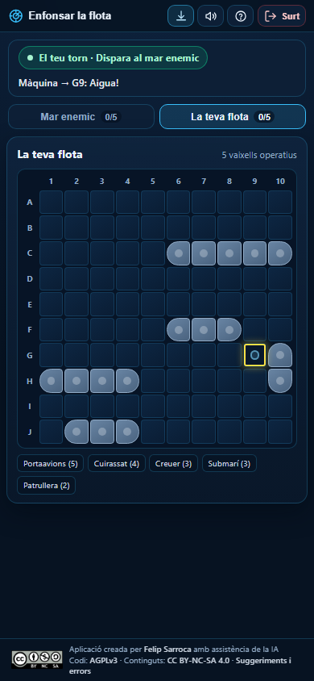

# Enfonsar la flota

Versió web i instal·lable (PWA) del joc tradicional de batalla naval, en català, pensada per jugar tant des de l'ordinador com des del mòbil.

## Característiques principals

- **Partides en línia amb codi de sala:** un jugador crea una sala i obté un codi de 5 caràcters, un enllaç directe i un codi QR per convidar el rival en segons.
- **Sincronització en temps real:** comunicació mitjançant Firebase Firestore (`flota-naval-cat`, regió `eur3`) amb reconnexió automàtica si es recarrega la pàgina o es bloqueja el mòbil.
- **Joc net verificat:** les posicions dels vaixells no surten del navegador durant la partida; s'envia una empremta SHA-256 a l'inici i es verifica al final.
- **Contra la màquina (també sense internet):** tres nivells d'IA (*Grumet*, *Capità* i *Almirall* amb càlcul de densitat probabilística).
- **Regles tradicionals:** tauler `10×10` (`A–J`, `1–10`), flota clàssica de 5 vaixells (*Portaavions* 5, *Cuirassat* 4, *Creuer* 3, *Submarí* 3 i *Patrullera* 2) i 1 tret per torn.
- **Instal·lable al mòbil i a l'ordinador:** botó visible per instal·lar l'app (amb prompt directe a Android/Chrome i guia visual per a Safari a iOS) i *Service Worker* per jugar contra la màquina fora de línia.
- **Àudio tàctic sintètic:** efectes de radar, aigua, impacte i enfonsament generats per Web Audio API, amb botó de silenci.

## Captures de pantalla

### Pantalla inicial (ordinador i mòbil)

### Col·locació de la flota i combat

## Estructura del projecte

- [index.html](index.html) — Estructura de les pantalles, modals i peu de llicència.
- [css/estil.css](css/estil.css) — Disseny *Carta nàutica i radar tàctic* adaptat a 1366×740, 1920×1080 i mòbil.
- [js/engine.js](js/engine.js) — Motor de regles 10×10, hash SHA-256 i IA de tres nivells.
- [js/net.js](js/net.js) — Client de sales en línia sobre Firebase Firestore.
- [js/qr.js](js/qr.js) — Generador propi de codis QR en SVG sense dependències externes.
- [js/audio.js](js/audio.js) — Efectes sonors amb Web Audio API.
- [js/app.js](js/app.js) — Controlador de la interfície, instal·lació PWA i flux de partida.
- [manifest.webmanifest](manifest.webmanifest) i [sw.js](sw.js) — Configuració PWA i memòria cau fora de línia.
- [firebase/firestore.rules](firebase/firestore.rules) — Regles de seguretat de Firestore.

## Llicència

Aquest projecte té una llicència doble ([LICENSE](LICENSE)):

- **Codi font (HTML, CSS i JavaScript):** GNU AGPLv3 o posterior.
- **Continguts, icones i disseny gràfic:** Creative Commons BY-NC-SA 4.0.
