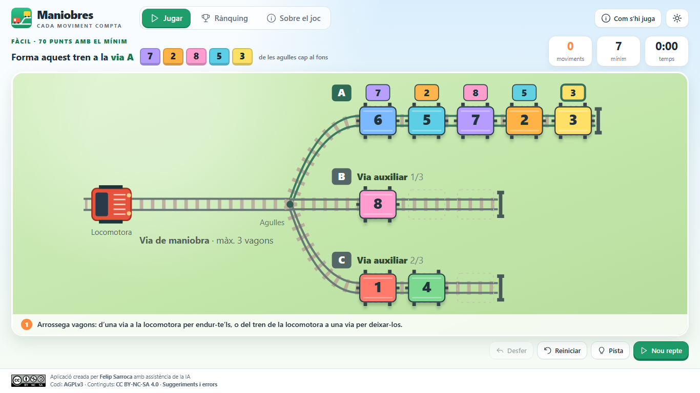
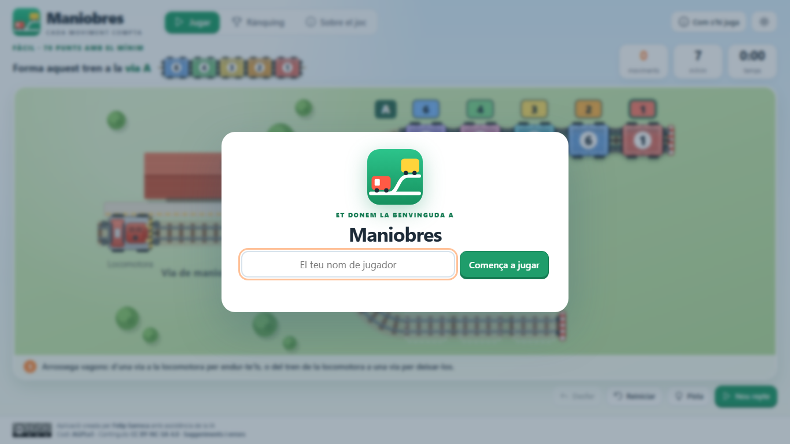
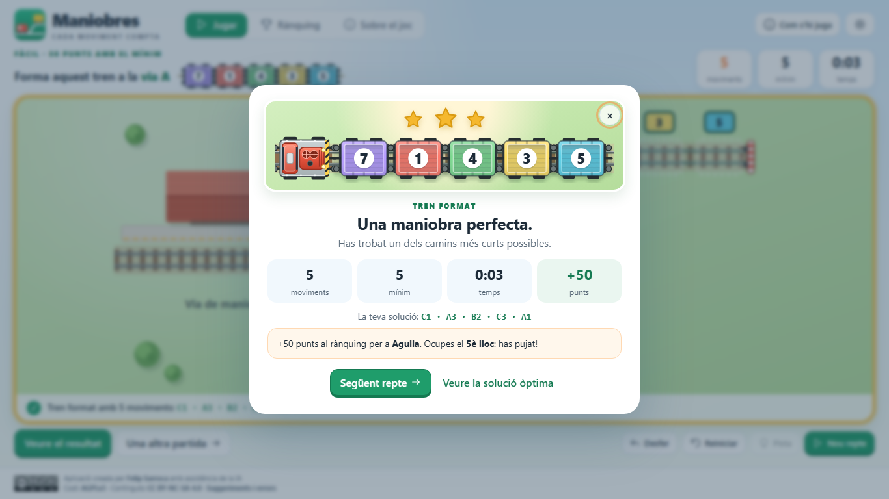
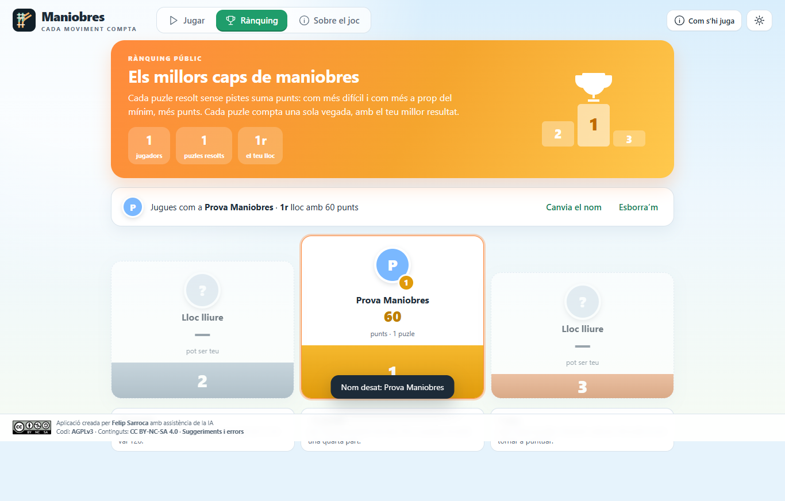
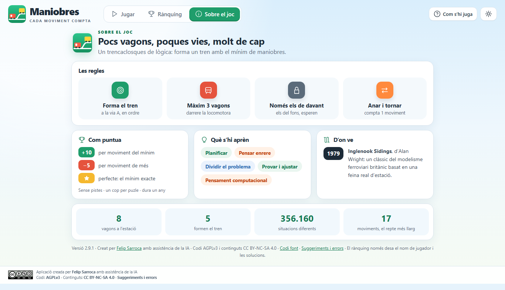

# Maniobres

**Cada moviment compta.** Un puzle ferroviari en català inspirat en l’**Inglenook Sidings** d’Alan Wright (1979).

**[Juga a Maniobres](https://ja.cat/maniobres)** · [Guia docent](docs/guia-docent.md) · [Revisió crítica](docs/revisio.md)



## El joc

Forma el tren objectiu a la via A, en l’ordre indicat des de les agulles fins al fons. Arrossega vagons d’una via a la locomotora o de la locomotora a una via. Cada anada i tornada de la locomotora compta com una maniobra. Només es poden agafar els vagons accessibles i cada via té una capacitat limitada.

La versió 2.0 és deliberadament senzilla: **Jugar**, **Rànquing** i **Sobre el joc**.

- **Jugar:** quatre dificultats (fàcil, mitjà, difícil i expert) segons el mínim de moviments. S’eviten els puzles que ja has resolt en aquest navegador.
- Tutorial, mínim i moviments restants, pistes, desfer, reinici, reproducció de la solució òptima i so opcional.
- SVG originals, números a més de colors, teclat, moviment reduït i disseny adaptable.
- PWA: el joc funciona sense connexió després de la primera càrrega; el rànquing necessita connexió.





### Controls

Ratolí o tacte: **arrossega** un vagó d’una via fins a la locomotora per endur-te’l (amb els que té davant), o un vagó del tren de la locomotora fins a una via per deixar-lo (amb els que té darrere). També pots tocar una via i després el darrer vagó que vols endur-te. Teclat: **A/B/C**, després **0–3** o fletxes i Retorn; **Z** desfà.

## Rànquing públic



La captura mostra un jugador creat per a les proves i eliminat després.

- En entrar per primer cop, una benvinguda demana el **nom de jugador** únic (3–16 caràcters), sense contrasenya; així tothom surt al rànquing. El dispositiu el recorda i, si el navegador perd la sessió, el recupera sol. Des d’un altre dispositiu es pot continuar amb el mateix nom: el joc avisa que ja s’ha fet servir i, si el jugador confirma que és seu, s’hi trasllada amb tots els punts (l’altre dispositiu en queda desvinculat fins que hi torni a continuar). Hi ha un filtre de paraules ofensives i l’avís de no fer servir el nom real.
- Cada puzle resolt **sense pistes** suma **10 punts per moviment del mínim**, menys 5 per cada moviment de més, amb un terra d’una quarta part. Un puzle de 12 moviments resolt en 12 val 120 punts.
- Cada puzle compta **una sola vegada**, amb el millor resultat. Cada resultat **caduca al cap d’un any**.
- Llista de tots els participants ordenada per punts (medalla per als tres primers), amb els puzles resolts, els perfectes (resolts amb el mínim de moviments) i una barra de punts; en tocar un jugador, la seva fitxa amb cada puzle resolt (dificultat, data, moviments respecte del mínim, temps i punts) i un botó per jugar el mateix puzle; fitxa pròpia (lloc, punts, puzles i perfectes), canvi de nom i esborrament de les dades pròpies.
- Les solucions es comproven tornant-les a jugar amb el motor i la taula de mínims a cada navegador que obre el rànquing: una solució falsa no puntua. No pot demostrar l’absència d’ajuda externa; és una classificació lúdica.



## Matemàtiques verificades

El model clàssic té 403.200 posicions inicials etiquetades i 6.720 trens objectiu: 2.709.504.000 combinacions. Identificant els tres vagons sobrants s’obtenen **356.160 estats**, dels quals **67.200** són inicials. El màxim del mínim és **17**, la mitjana és **11,5416** i hi ha **32** situacions inicials reduïdes de 17 moviments.

Les taules binàries contenen una distància exacta per estat. Un Web Worker les consulta sense bloquejar la interfície. Les pistes segueixen un veí amb distància inferior en una unitat. 

Les etiquetes visibles dels vagons es barregen de manera determinista: la mateixa URL sempre presenta el mateix puzle i els mateixos números. Els identificadors `v1-classic-…` inclouen la versió de representació. No es canvia el catàleg d’una versió publicada sense mantenir els identificadors anteriors.

## Desenvolupament i proves

Aplicació estàtica amb mòduls JavaScript estàndard, SVG i CSS. No necessita compilació ni dependències externes durant el joc. Node.js 24 s’ha utilitzat per generar les dades i executar les proves.

```sh
npm ci
npm test
npm run serve
```

Obre `http://127.0.0.1:4173/`. En una altra terminal:

```sh
node tests/browser.mjs
node tests/flows.mjs
```

Les proves de navegador requereixen Chrome i Playwright.

```sh
npm run generate
```

Regenera les set taules, el catàleg i les estadístiques. Les proves comproven tots els 818 reptes del catàleg, la reversibilitat dels moviments, les capacitats, els recomptes clàssics i la recuperació del tren en el mínim anunciat.

```text
src/       motor, interfície, solucionador en Worker i client del rànquing
data/      taules binàries, catàleg i estadístiques reproduïbles
assets/    SVG propi i distintiu de llicència
firebase/  regles de seguretat de Firestore
scripts/   generació de dades i servidor de desenvolupament
tests/     motor, navegador i fluxos complets
docs/      guia docent, revisió crítica i captures
```

## Publicació i servei compartit

El frontend viu a GitHub Pages, dins del repositori `felipsarroca/jocs`. Els fitxers publicats són els mateixos que hi ha en aquesta carpeta. La CI comprova el motor i la sintaxi.

El rànquing usa el projecte Firebase dedicat **maniobres-cat** (Firestore a `eur3`, pla gratuït Spark) amb accés anònim. La configuració web de `src/ranking.js` és pública per disseny; la seguretat la donen les regles de `firebase/firestore.rules`:

- cada jugador només pot escriure el seu document i reservar el seu nom;
- cada actualització afegeix o millora com a molt un resultat, amb l’hora del servidor i un format de solució vàlid;
- la lectura és pública.

Per desplegar les regles: `cd firebase` i `firebase deploy --only firestore:rules --project maniobres-cat`.

Per a una actualització, executa les proves, actualitza la versió de la memòria cau de `sw.js` quan canviïn recursos i publica els fitxers. El nou service worker s’activa quan es tanquen les pestanyes antigues.

## Privacitat i ús escolar

No es demanen correus, contrasenyes ni edats. El rànquing desa el nom de jugador, les solucions i les dates. No hi ha analítica ni publicitat. El botó «Esborra’m» elimina el nom i tots els resultats propis. Un nom que permeti identificar un alumne és una dada personal: cal demanar noms de joc i que el centre en validi l’ús.

Materials preparats i revisats tècnicament i visualment. **Pendents de validació amb alumnat.**

## Autoria i llicència

Aplicació creada per **Felip Sarroca amb assistència de la IA**. El nom «Maniobres» descriu les operacions d’ordenar, enganxar i separar vehicles dins d’un espai limitat.

- Alan Wright: Inglenook Sidings, 1979.
- [Simon R. Blackburn, *Inglenook Shunting Puzzles*](https://arxiv.org/abs/1810.07970).
- [Adrian Wymann, *Model Railways Shunting Puzzles*](https://www.wymann.info/ShuntingPuzzles/).

Codi: [AGPLv3](LICENSE) · Continguts (textos, SVG originals i materials): [CC BY-NC-SA 4.0](https://creativecommons.org/licenses/by-nc-sa/4.0/deed.ca) · [Suggeriments i errors](https://github.com/felipsarroca/jocs/issues/new?template=maniobres.yml). El rànquing carrega el SDK de Firebase (Apache 2.0) des de gstatic.com. No s’han utilitzat recursos visuals de tercers.
