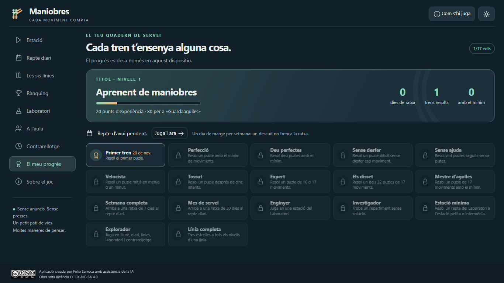

# Maniobres

**Cada moviment compta.** Un puzle ferroviari en català inspirat en l’**Inglenook Sidings** d’Alan Wright (1979).

**[Juga a Maniobres](https://ja.cat/maniobres)** · [Guia docent](docs/guia-docent.md) · [Revisió crítica](docs/revisio.md)


## El joc

Forma el tren objectiu a la via A, en l’ordre indicat des de les agulles fins al fons. Tria una via i el nombre total de vagons amb què vols tornar. Entrar i tornar compta com una maniobra. Només es poden recollir els vagons accessibles; cada via té una capacitat limitada.

- **Partida lliure:** quatre dificultats, amb selecció entre totes les situacions inicials clàssiques del nivell. S’exclouen les partides que ja has resolt en aquest dispositiu.
- **Campanya:** 60 reptes en sis línies, de l’estació petita als reptes de 17 moviments.
- **Repte diari:** el mateix per a tothom, segons la data d’Europa/Madrid.
- **Laboratori:** set estacions amb estadístiques exactes i repartiments experimentals, inclosos casos sense solució.
- **Contrarellotge:** cinc minuts, opcional i fora del rànquing.
- **A l’aula:** sales amb codi, puzle compartit, rànquing del grup i exportació CSV per al creador.
- **El meu progrés:** experiència i cinc títols (d’Aprenent de maniobres a Mestre d’agulles), ratxa del repte diari amb un dia de marge per setmana, rècords personals per puzle i 17 èxits. Tot es desa al dispositiu.
- Tutorial, mínim inicial i restant, pistes (cada pista resta una estrella possible), desfer, historial, reproducció òptima, fitxa imprimible amb QR, projector i so opcional.
- SVG originals, números a més de colors, teclat, moviment reduït i disseny adaptable.
- PWA amb recursos locals: joc sense connexió després de la primera càrrega completa. Les sales i el rànquing requereixen connexió.



### Controls

Ratolí o tacte: **arrossega** un vagó d’una via fins a la locomotora per endur-te’l (amb els que té davant), o un vagó del tren de la locomotora fins a una via per deixar-lo (amb els que té darrere). També pots tocar una via i després el darrer vagó que vols endur-te, o fer servir els botons amb el nombre de vagons. Teclat: **A/B/C**, després **0–3** o fletxes i Retorn; **Z** desfà. Els botons també admeten Tab i Retorn. Desfer no penalitza: el recompte correspon a la solució activa. Els vagons sobrants poden quedar enganxats a la locomotora al final.

## Rànquing amb caducitat


La captura mostra tres participants creats exclusivament per a les proves i eliminats després. El joc publicat no incorpora resultats ficticis.

- Temporades mensuals segons Europa/Madrid i classificació del dia.
- Només el millor resultat per jugador, dia i sala: repetir un puzle no acumula punts.
- 100 punts amb el mínim; −5 per moviment extra, amb un terra de 10 punts.
- Els empats comparteixen posició. El temps no desempata.
- Pòdium visual, indicador de temporada i ressaltat del jugador propi.
- Resultats ocults en caducar als **30 dies**; eliminació física diària a les 03:15 UTC. Les sales també caduquen als 30 dies.
- Publicació voluntària. Les partides amb pistes o reproducció de solucions no es poden publicar des de la interfície.
- El servidor reprodueix la solució amb el mateix motor, valida l’objectiu i calcula els punts. No pot demostrar l’absència d’ajuda externa: és una classificació lúdica.

## Matemàtiques verificades

El model clàssic té 403.200 posicions inicials etiquetades i 6.720 trens objectiu: 2.709.504.000 combinacions. Identificant els tres vagons sobrants s’obtenen **356.160 estats**, dels quals **67.200** són inicials. El màxim del mínim és **17**, la mitjana és **11,5416** i hi ha **32** situacions inicials reduïdes de 17 moviments.

Les taules binàries contenen una distància exacta per estat. Un Web Worker les consulta sense bloquejar la interfície. Les pistes segueixen un veí amb distància inferior en una unitat. El Laboratori és deliberadament acotat a set configuracions per garantir-ne els resultats.

Les etiquetes visibles dels vagons es barregen de manera determinista: la mateixa URL sempre presenta el mateix puzle i els mateixos números. Els identificadors `v1-classic-…` inclouen la versió de representació. No es canvia el catàleg d’una versió publicada sense mantenir els identificadors anteriors.

## Desenvolupament i proves

Aplicació estàtica amb mòduls JavaScript estàndard, SVG i CSS. No necessita compilació ni dependències externes durant el joc. Node.js 24 s’ha utilitzat per generar les dades i executar les proves.

```sh
npm ci
npm test
npm run serve
```

Obre `http://127.0.0.1:4173/`. En una altra terminal:

```sh
node tests/browser.mjs
node tests/flows.mjs
```

Les proves de navegador requereixen Chrome i Playwright. Les proves `node tests/online.mjs` consulten el servidor real, creen identitats i sales temporals de prova i les eliminen en acabar.

```sh
npm run generate
```

Regenera les set taules, el catàleg i les estadístiques. Les proves comproven tots els 818 reptes del catàleg, la reversibilitat dels moviments, les capacitats, els recomptes clàssics i la recuperació del tren en el mínim anunciat.

```text
src/       motor, progrés, interfície, solucionador en Worker i client del rànquing
data/      taules binàries, catàleg i estadístiques reproduïbles
assets/    SVG propi, distintiu de llicència i generador QR local
server/    esquema SQL i Edge Function de validació
scripts/   generació de dades i servidor de desenvolupament
tests/     motor, progrés, navegador, fluxos complets i integració remota
docs/      guia docent, revisió crítica, captures i fitxa d’exemple
```

## Publicació i servei compartit

El frontend viu a GitHub Pages, dins del repositori `felipsarroca/jocs`. Els fitxers publicats són els mateixos que hi ha en aquesta carpeta. La CI comprova el motor i la sintaxi.

El servidor és el projecte Supabase dedicat **Maniobres**, regió `eu-west-1`, referència `zcwsqrgxoxvjbvpulroq`. El cost indicat en crear-lo era de 0 €/mes; cal revisar les quotes si creix l’ús. No depèn dels altres projectes de Felip.

`server/schema.sql` documenta la migració aplicada. L’Edge Function `maniobres` es desplega amb `server/index.ts`, `src/engine.js` i `data/catalog.json`, preservant aquestes rutes. `verify_jwt=false` és intencional: és una API pública que valida les capacitats de dispositiu i les solucions; no usa sessions de Supabase Auth.

Les taules tenen RLS activada i no concedeixen accés a `anon` ni `authenticated`. Només l’Edge Function utilitza la clau de servei, llegida de l’entorn del servidor. **No hi ha secrets al frontend.** El token de dispositiu només es conserva al seu navegador; al servidor se’n desa el resum SHA-256. Hi ha límits de peticions i d’enviaments.

Per a una actualització, executa les proves, actualitza la versió de la memòria cau de `sw.js` quan canviïn recursos i publica els fitxers. El nou service worker s’activa quan es tanquen les pestanyes antigues.

## Privacitat i ús escolar

No es demanen noms, correus ni edats. La publicació envia un identificador pseudònim, el puzle, la seqüència, la durada i la data. No hi ha analítica ni publicitat. El proveïdor pot conservar registres tècnics de connexió segons les seves polítiques. El botó d’esborrament elimina els resultats i les sales pròpies del servidor i el progrés local.

Un pseudònim vinculable a un alumne continua sent dada personal. El centre ha de validar l’ús i la base jurídica del tractament. El codi de sala dona accés al seu tauler: cal compartir-lo només amb el grup. El control de la sala queda vinculat al navegador creador; no hi ha recuperació de comptes entre dispositius.

Materials preparats i revisats tècnicament i visualment. **Pendents de validació amb alumnat.**

## Autoria i llicència

Aplicació creada per **Felip Sarroca amb assistència de la IA**. El nom «Maniobres» descriu les operacions d’ordenar, enganxar i separar vehicles dins d’un espai limitat.

- Alan Wright: Inglenook Sidings, 1979.
- [Simon R. Blackburn, *Inglenook Shunting Puzzles*](https://arxiv.org/abs/1810.07970).
- [Adrian Wymann, *Model Railways Shunting Puzzles*](https://www.wymann.info/ShuntingPuzzles/).

Codi: [AGPLv3](LICENSE) · Continguts (textos, SVG originals i materials): [CC BY-NC-SA 4.0](https://creativecommons.org/licenses/by-nc-sa/4.0/deed.ca) · [Suggeriments i errors](https://github.com/felipsarroca/jocs/issues/new?template=maniobres.yml). El generador QR de Kazuhiko Arase conserva la seva llicència MIT i els crèdits a `assets/qrcode.js`. No s’han utilitzat recursos visuals de tercers.
