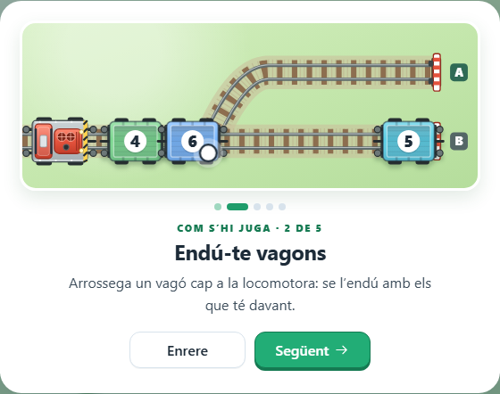
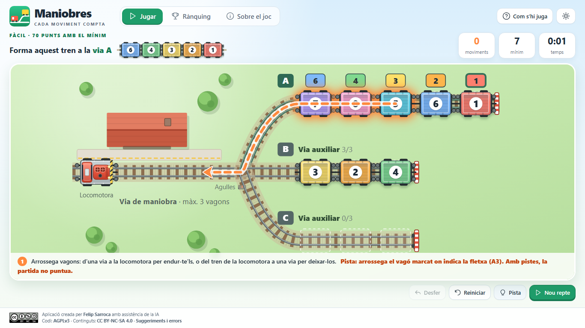
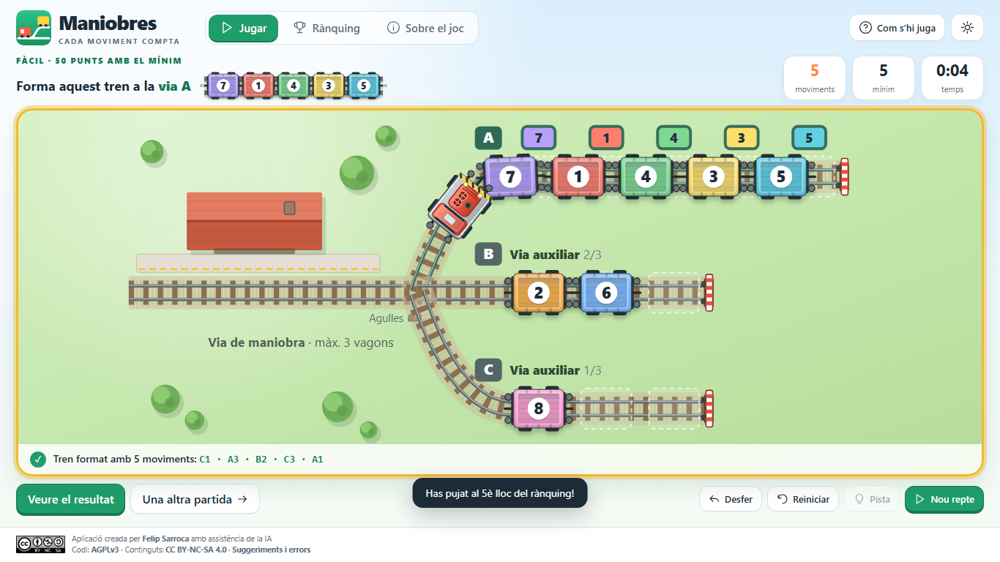
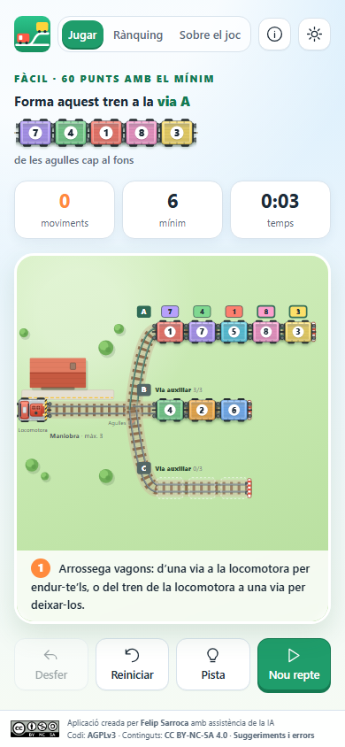
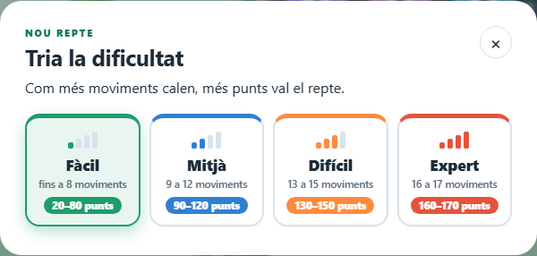
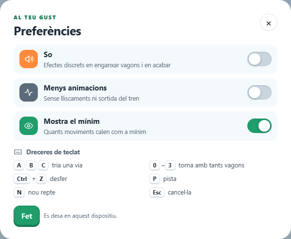
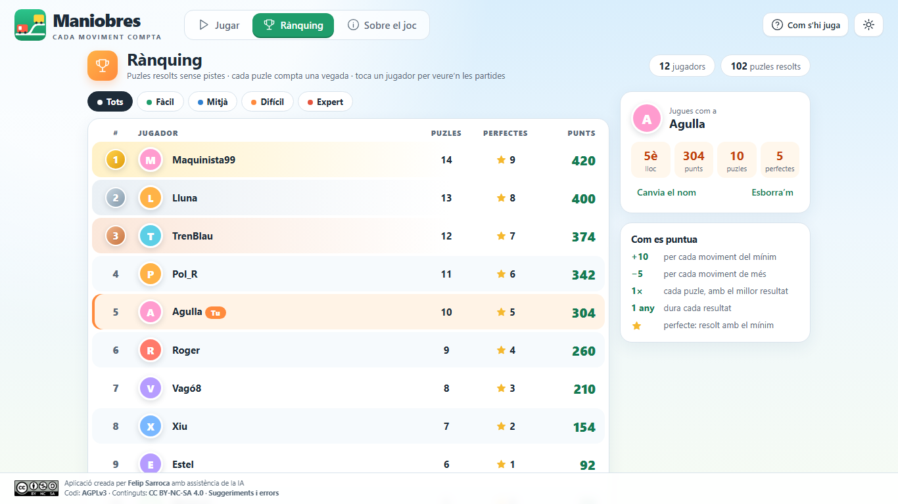

<div align="center">


# Maniobres

**Cada moviment compta.**
Un trencaclosques ferroviari en català: pocs vagons, poques vies i molt de cap.

**[Juga ara a ja.cat/maniobres](https://ja.cat/maniobres)**


[Guia docent](docs/guia-docent.md) · [Revisió crítica](docs/revisio.md) · [Historial de canvis](CHANGELOG.md) · [Suggeriments i errors](https://github.com/felipsarroca/jocs/issues/new?template=maniobres.yml)


</div>

## Què és

Maniobres és una versió en català de l’**Inglenook Sidings**, el clàssic del modelisme ferroviari britànic que Alan Wright va idear el 1979 a partir d’una feina real d’estació. L’estació té una via de maniobra, una locomotora i tres vies sense sortida. La teva feina és **formar a la via A un tren concret, en l’ordre exacte, amb el mínim de moviments possible**.

Sembla fàcil: només hi ha vuit vagons. Però l’espai és el repte, i cada solució obliga a planificar, pensar enrere i dividir el problema en parts.

## Com es juga

1. **Forma el tren** que es mostra a dalt a la via A, plaça per plaça.
2. **La locomotora porta com a molt tres vagons.** La via A n’admet cinc; les vies B i C, tres cadascuna.
3. **Només pots agafar els vagons de davant**, els més propers a les agulles. Els del fons s’han d’esperar.
4. **Cada anada i tornada de la locomotora és un moviment.**

**Arrossega** un vagó d’una via cap a la locomotora per endur-te’l (amb els que té davant), o un vagó del tren de la locomotora cap a una via per deixar-lo (amb els que té darrere). Els vagons llisquen seguint els rails. També pots tocar una via i triar amb quants vagons torna la locomotora.

<table>
<tr>
<td width="50%"></td>
<td width="50%"></td>
</tr>
<tr>
<td><b>Com s’hi juga.</b> Cinc passos curts, cadascun amb una escena animada de l’estació, i una partida de pràctica.</td>
<td><b>Pistes visuals.</b> El vagó que cal moure batega i una fletxa marca el recorregut. Amb pistes, la partida no puntua.</td>
</tr>
<tr>
<td></td>
<td></td>
</tr>
<tr>
<td><b>El tren surt.</b> En acabar, la locomotora deixa els vagons que porta en una via auxiliar, s’enganxa al tren format i se l’emporta.</td>
<td><b>Resultat.</b> Estrelles, moviments, mínim, temps, punts i el teu lloc al rànquing.</td>
</tr>
</table>

### Dreceres de teclat

| Tecla | Acció |
|---|---|
| <kbd>A</kbd> <kbd>B</kbd> <kbd>C</kbd> | Tria una via |
| <kbd>0</kbd>–<kbd>3</kbd> | La locomotora torna amb tants vagons |
| <kbd>Ctrl</kbd>+<kbd>Z</kbd> o <kbd>Z</kbd> | Desfer |
| <kbd>P</kbd> | Pista |
| <kbd>N</kbd> | Nou repte |
| <kbd>Esc</kbd> | Cancel·la la selecció o la pista |

## Què hi trobaràs

- **Quatre nivells** segons el mínim de moviments: Fàcil (fins a 8), Mitjà (9–12), Difícil (13–15) i Expert (16–17). El joc evita els puzles que ja has resolt en aquell navegador.
- **Ajudes:** desfer sense penalització, reiniciar, pistes visuals, el mínim de moviments i els que en queden, i la reproducció d’una solució òptima.
- **Rànquing públic** general i per nivells, amb la fitxa de partides de cada jugador.
- **Preferències** amb interruptors: so discret, menys animacions i mostrar o amagar el mínim. Des d’aquí també es pot **instal·lar el joc com una app**.
- **Disseny adaptat a cada pantalla:** sense desplaçament a 1366 × 768, també amb escalat del 125 % i del 150 %, i una disposició pròpia per al mòbil.
- **Mòbil horitzontal:** en girar el mòbil, només es veu el tauler, a pantalla completa, amb els vagons gairebé el doble de grans; els comptadors i els botons queden petits als racons. Amb el dit, un toc una mica fora d’un vagó també l’agafa.
- **Accessible:** números a més de colors, teclat complet, etiquetes per a lectors de pantalla i opció de moviment reduït.
- **Sense connexió:** és una PWA; després de la primera càrrega, el joc funciona sense xarxa. El rànquing sí que necessita connexió.

<table>
<tr>
<td width="34%" align="center"></td>
<td width="66%">

<br><br>

</td>
</tr>
</table>

## Rànquing



*La captura mostra jugadors fictics.*

- **Nom de jugador únic** (3–16 caràcters), sense contrasenya ni correu. Una benvinguda el demana el primer cop. El dispositiu el recorda i, si el navegador perd la sessió, el recupera sol.
- **Canvi de dispositiu:** si escrius un nom que ja existeix, el joc t’avisa i, si confirmes que és teu, hi continues amb tots els punts. Hi ha un filtre de paraules ofensives i l’avís de no fer servir el nom real.
- **Puntuació:** cada puzle resolt **sense pistes** suma **10 punts per moviment del mínim** i en resta 5 per cada moviment de més, amb un mínim d’una quarta part. Un puzle de 12 moviments resolt en 12 val 120 punts.
- Cada puzle compta **una sola vegada**, amb el millor resultat, i cada resultat **caduca al cap d’un any**.
- **Llista de tots els participants** ordenada per punts, amb medalla per als tres primers, puzles resolts, perfectes (amb el mínim exacte) i pestanyes per nivell. Tocant un jugador s’obre la seva fitxa: cada puzle amb dificultat, data, moviments, temps i punts, i un botó per jugar el mateix puzle.
- **Verificació:** cada navegador que obre el rànquing torna a jugar totes les solucions amb el motor i la taula de mínims, i una solució falsa no puntua. No pot demostrar l’absència d’ajuda externa: és una classificació lúdica.

<div align="center"></div>

## A l’aula

Maniobres treballa el **pensament computacional** i la **resolució de problemes**: planificar abans d’actuar, descompondre un objectiu gran en passos, raonar cap enrere des del resultat i comparar la pròpia solució amb l’òptima. La [guia docent](docs/guia-docent.md) proposa com fer-lo servir a classe.

- **Privacitat:** no es demanen correus, contrasenyes ni edats. El rànquing desa només el nom de jugador, les solucions i les dates. No hi ha analítica ni publicitat. El botó «Esborra’m» elimina el nom i tots els resultats propis.
- Un nom que permeti identificar un alumne és una dada personal: cal demanar noms de joc i que el centre en validi l’ús.
- Materials revisats tècnicament i visualment. **Pendents de validació amb alumnat.**

<div align="center"></div>

## Les matemàtiques del joc

El model clàssic té 403.200 posicions inicials etiquetades i 6.720 trens objectiu: **2.709.504.000 combinacions**. Si es consideren iguals els tres vagons sobrants, en queden **356.160 estats**, dels quals **67.200** són inicials.

| Dada | Valor |
|---|---|
| Mínim més llarg | **17 moviments** |
| Mitjana del mínim | **11,5416** moviments |
| Situacions inicials de 17 moviments | **32** |
| Reptes del catàleg | **818** |

Unes taules binàries guarden la distància exacta de cada estat a la solució. Un Web Worker les consulta sense bloquejar la interfície, i les pistes segueixen sempre un estat amb una distància una unitat menor.

Els números visibles dels vagons es barregen de manera determinista: la mateixa URL sempre mostra el mateix puzle amb els mateixos números. Els identificadors `v1-classic-…` inclouen la versió de representació; no es canvia el catàleg d’una versió publicada sense mantenir els identificadors anteriors.

## Desenvolupament

Aplicació estàtica amb mòduls JavaScript estàndard, SVG i CSS. No necessita compilació ni dependències durant el joc. S’ha fet servir Node.js 24 per generar les dades i executar les proves.

```sh
npm ci
npm test          # motor, catàleg i regles
npm run serve     # http://127.0.0.1:4173/
```

Amb el servidor en marxa, en una altra terminal (cal Chrome i Playwright):

```sh
node tests/browser.mjs   # pantalles i captures
node tests/flows.mjs     # partides completes, arrossegar, sense connexió…
```

`npm run generate` regenera les set taules, el catàleg i les estadístiques. Les proves comproven els 818 reptes del catàleg, la reversibilitat dels moviments, les capacitats, els recomptes clàssics i que el tren es pot formar en el mínim anunciat.

```text
src/       motor, interfície, solucionador en Worker i client del rànquing
data/      taules binàries, catàleg i estadístiques reproduïbles
assets/    icona i distintiu de llicència
firebase/  regles de seguretat de Firestore
scripts/   generació de dades i servidor de desenvolupament
tests/     motor, navegador i fluxos complets
docs/      guia docent, revisió crítica i captures
```

### Publicació

El joc es publica a GitHub Pages, dins del repositori `felipsarroca/jocs`, i s’hi arriba des de [ja.cat/maniobres](https://ja.cat/maniobres). La CI comprova el motor i la sintaxi. A cada canvi de recursos cal incrementar la versió de la memòria cau a `sw.js` (i la versió a `package.json`, `CHANGELOG.md` i «Sobre el joc»). El nou service worker s’activa quan es tanquen les pestanyes antigues.

El rànquing fa servir el projecte Firebase **maniobres-cat** (Firestore a `eur3`, pla gratuït Spark) amb accés anònim. La configuració web de `src/ranking.js` és pública per disseny; la seguretat la donen les regles de `firebase/firestore.rules`:

- cada jugador només pot escriure el seu document i reservar el seu nom;
- cada actualització afegeix o millora com a molt un resultat, amb l’hora del servidor i un format de solució vàlid;
- la lectura és pública.

Per desplegar les regles: `cd firebase` i `firebase deploy --only firestore:rules --project maniobres-cat`.

## Autoria, fonts i llicència

Aplicació creada per **Felip Sarroca amb assistència de la IA**. El nom «Maniobres» descriu les operacions d’ordenar, enganxar i separar vagons dins d’un espai limitat.

- Alan Wright: *Inglenook Sidings*, 1979.
- [Simon R. Blackburn, *Inglenook Shunting Puzzles*](https://arxiv.org/abs/1810.07970).
- [Adrian Wymann, *Model Railways Shunting Puzzles*](https://www.wymann.info/ShuntingPuzzles/).

**Codi:** [AGPLv3](LICENSE) · **Continguts** (textos, SVG originals i materials): [CC BY-NC-SA 4.0](https://creativecommons.org/licenses/by-nc-sa/4.0/deed.ca) · [Suggeriments i errors](https://github.com/felipsarroca/jocs/issues/new?template=maniobres.yml).

El rànquing carrega el SDK de Firebase (Apache 2.0) des de gstatic.com. Tots els dibuixos són originals: no s’han fet servir recursos visuals de tercers.
